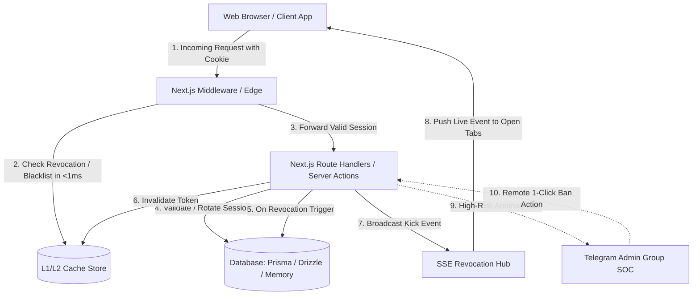

# Next-Session-Guard Documentation 📚

Welcome to the official technical documentation for **Next-Session-Guard** (v2.0.1) — the enterprise-grade multi-device session management, real-time revocation, session hijacking defense, and autonomous Telegram SOC suite for Next.js (App Router), Prisma, and Drizzle ORM.

---

## 🗺️ Documentation Map

| Guide | Description | Target Audience |
| :--- | :--- | :--- |
| [🚀 Getting Started](./getting-started.md) | 5-minute fast-track setup, installation, ORM schemas, and first protected route | All Developers |
| [🏗️ Architecture & Lifecycle](./architecture.md) | Deep dive into request lifecycles, cache layers, SSE event mesh, and security pipelines | Architects & Tech Leads |
| [📖 API Reference](./api-reference.md) | Complete reference for all exports across `/server`, `/client`, `/cache`, `/realtime`, `/telegram` | Developers & Integrators |
| [⚡ Caching & Edge Performance](./cache-adapters.md) | In-Memory, Upstash Redis, Dragonfly, and custom cache adapters with sub-millisecond lookups | DevOps & Performance Engineers |
| [📡 Real-Time SSE Revocation](./realtime-sse.md) | Instant browser lock without polling, heartbeat channels, and reconnect resilience | Frontend & Fullstack Devs |
| [🛡️ Security & Hijacking Defense](./security-and-hijacking.md) | Kinetic Impossible Travel (Mach velocity), IP subnet drift, and device fingerprint binding | SecOps & Engineers |
| [🤖 Telegram Admin SOC Suite](./telegram-soc.md) | Telegram SOC setup, HMAC-SHA256 compact 64-byte Action Vault, and webhook lockdown | SysAdmins & Incident Responders |
| [⚡ Next.js 15 & Server/Client Boundary](./nextjs-15-guide.md) | Clean separation of Server Actions, Route Handlers, RSCs, and Client Components | Next.js Engineers |
| [🔄 Migration Guide](./migration-guide.md) | Upgrading from v1.x or legacy setups to v2.0.1 modular subpaths | Existing Users |
| [❓ FAQ & Troubleshooting](./faq.md) | Frequently asked questions, Edge runtime considerations, and common debugging tips | Support & Maintenance |

---

## 🏛️ System Overview



---

## ⚡ Quick Start Snippet

```typescript
// app/api/auth/login/route.ts
import { NextResponse } from "next/server";
import { SessionManager, createPrismaAdapter } from "next-session-guard/server";
import { prisma } from "@/lib/prisma";

const sessionManager = new SessionManager(createPrismaAdapter(prisma));

export async function POST(req: Request) {
  const { userId, email } = await req.json();

  const session = await sessionManager.createSession({
    userId,
    request: req,
    metadata: { email, role: "admin" },
    expiresInDays: 30
  });

  const response = NextResponse.json({ success: true, session });
  
  response.cookies.set("session_token", session.token, {
    httpOnly: true,
    secure: process.env.NODE_ENV === "production",
    sameSite: "lax",
    path: "/",
    expires: session.expiresAt
  });

  return response;
}
```

---

## 🤝 Community & Support

- **Repository:** [GitHub (MikeeeDeV/next-session-guard)](https://github.com/MikeeeDeV/next-session-guard)
- **Issues:** [GitHub Issue Tracker](https://github.com/MikeeeDeV/next-session-guard/issues)
- **Contributing:** [Contribution Guide](../CONTRIBUTING.md)
- **Code of Conduct:** [Contributor Covenant](../CODE_OF_CONDUCT.md)
- **Security Policy:** [Vulnerability Reporting](../SECURITY.md)
