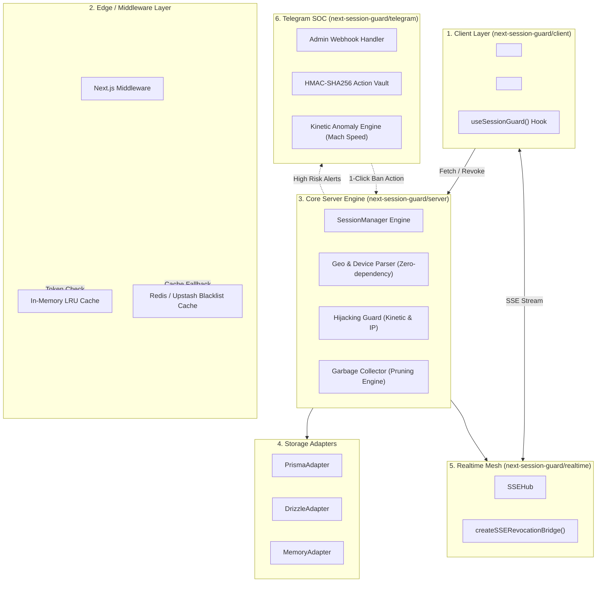
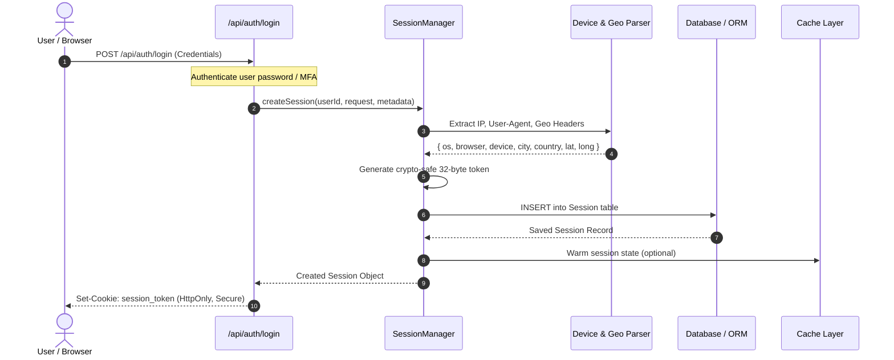
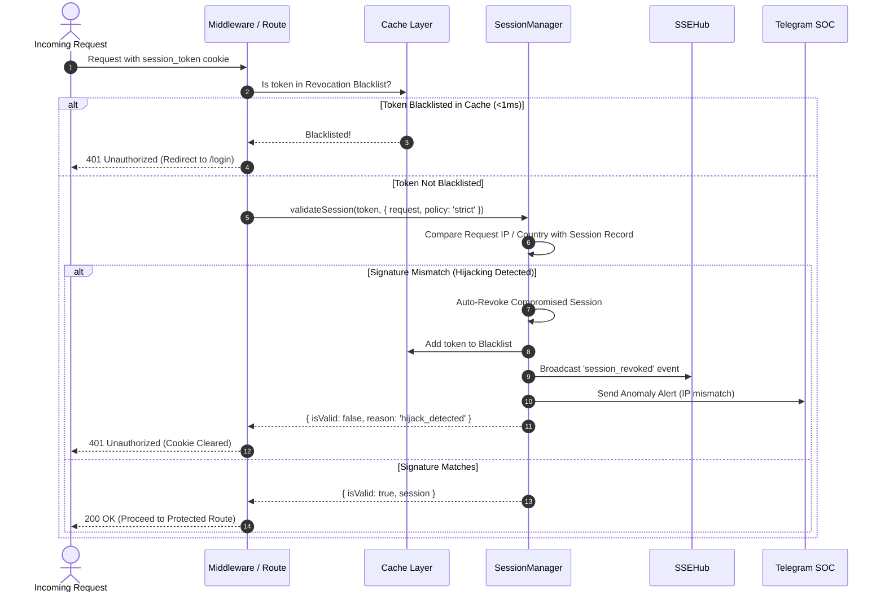
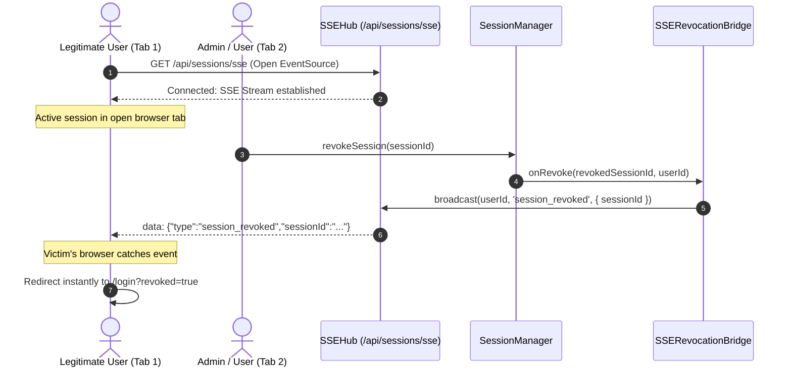
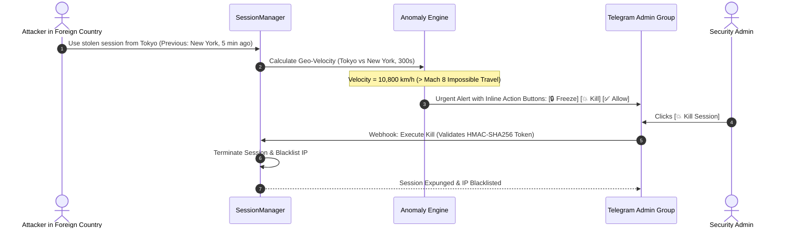

# Architecture & Lifecycle 🏗️

This document describes the architectural design, internal request flows, and security state machines of **Next-Session-Guard**.

---

## 🏛️ Layered Component Architecture

---

## 🔄 1. Session Creation Lifecycle

### Steps Explained:
1. **Header Inspection:** Inspects `x-forwarded-for`, `cf-connecting-ip`, `x-real-ip`, and Geo headers (`x-vercel-ip-country`, `cf-ipcountry`).
2. **Device Detection:** Internal regex engine classifies Android, iOS, Windows, macOS, Linux, and categorizes devices into Desktop, Mobile, Tablet, Bot, or Console.
3. **Cryptographic Entropy:** Tokens are generated using Node's `crypto.randomBytes(32).toString('hex')`.

---

## 🛡️ 2. Validation & Hijacking Defense Lifecycle

---

## ⚡ 3. Real-Time Remote Revocation Lifecycle (SSE)

---

## 🤖 4. Telegram SOC Autonomous Defense Loop

---

## 🔒 Fail-Safe Principles

1. **Defense in Depth:** The L1/L2 cache protects your database from being flooded during volumetric replay attacks.
2. **Zero Polling:** Revocation takes effect instantly via SSE, preventing stolen tokens from functioning while the victim is unaware.
3. **Strict HMAC Nonces:** Telegram action payloads are cryptographically signed and expire within 5 minutes to prevent replay attacks on SOC actions.
