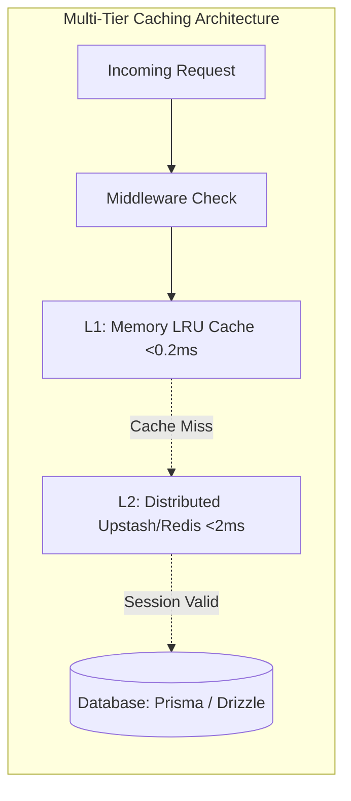

# Caching & Edge Performance ⚡

High-throughput session validation requires keeping database roundtrips to an absolute minimum. **Next-Session-Guard** includes a dedicated, high-performance caching layer (`next-session-guard/cache`) designed specifically for **sub-millisecond token blacklisting** and Edge middleware validation.

---

## 🚀 Why Caching Matters: DB vs Cache

In a typical web application, session validation occurs on **every single incoming HTTP request**. 

| Metric | Traditional DB Query | Next-Session-Guard Cache Layer |
| :--- | :--- | :--- |
| **Latency** | 15ms – 80ms (Connection pool overhead) | **< 1.0ms** (In-Memory / Edge Cache) |
| **Database Load** | 100% of HTTP traffic hits DB | **Zero DB hits** for blacklisted tokens |
| **Replay Attack Resistance** | Vulnerable to DB connection pool starvation | Handles 50,000+ req/sec effortlessly |
| **Edge Middleware Friendly** | ❌ Cannot run standard DB drivers on Edge | ✅ Runs natively on Vercel Edge / Cloudflare |

---

## 🗄️ Supported Cache Adapters



---

## 1. Upstash Redis Adapter (Serverless & Edge)

[Upstash Redis](https://upstash.com/) connects over HTTP/REST, making it 100% compatible with the Next.js Edge runtime, Vercel Serverless Functions, and Cloudflare Workers.

### Installation
```bash
npm install @upstash/redis
```

### Configuration
```typescript
// lib/cache.ts
import { Redis } from "@upstash/redis";
import { createUpstashRedisCacheAdapter } from "next-session-guard/cache";

const upstash = new Redis({
  url: process.env.UPSTASH_REDIS_REST_URL!,
  token: process.env.UPSTASH_REDIS_REST_TOKEN!,
});

export const cacheAdapter = createUpstashRedisCacheAdapter(upstash, {
  keyPrefix: "nsg:blacklist:",
  defaultTtlSeconds: 86400 * 30 // 30 days
});
```

---

## 2. In-Memory Cache Adapter (Zero-Config & Dev)

The in-memory adapter uses an optimized Least Recently Used (LRU) algorithm with an active TTL sweeper. It requires zero infrastructure and is ideal for single-instance servers, local development, and CI/CD pipelines.

```typescript
// lib/cache.ts
import { createMemoryCacheAdapter } from "next-session-guard/cache";

export const cacheAdapter = createMemoryCacheAdapter({
  maxItems: 50000,
  cleanupIntervalMs: 60000 // Cleans expired keys every 60 seconds
});
```

---

## 3. Redis / Dragonfly Adapter (Containers & VPS)

For enterprise self-hosted environments (Docker, Kubernetes, VPS) using [Dragonfly](https://dragonflydb.io/) or standard Redis via `ioredis`:

### Installation
```bash
npm install ioredis
```

### Configuration
```typescript
// lib/cache.ts
import Redis from "ioredis";
import { createRedisCacheAdapter } from "next-session-guard/cache";

const redis = new Redis(process.env.REDIS_URL || "redis://localhost:6379");

export const cacheAdapter = createRedisCacheAdapter(redis, {
  keyPrefix: "nsg:blacklist:"
});
```

---

## 🛡️ Edge Middleware Integration

Use the cache adapter directly inside `middleware.ts` to block revoked tokens before your application routes are even invoked:

```typescript
// middleware.ts
import { NextResponse, type NextRequest } from "next/server";
import { cacheAdapter } from "@/lib/cache";

export async function middleware(req: NextRequest) {
  const token = req.cookies.get("session_token")?.value;

  if (!token) {
    return NextResponse.redirect(new URL("/login", req.url));
  }

  // Instant O(1) blacklist check
  const isRevoked = await cacheAdapter.isBlacklisted(token);
  if (isRevoked) {
    const response = NextResponse.redirect(new URL("/login?revoked=true", req.url));
    response.cookies.delete("session_token");
    return response;
  }

  return NextResponse.next();
}

export const config = {
  matcher: ["/dashboard/:path*", "/admin/:path*"]
};
```

---

## 📊 Benchmarks

Benchmark executed with `autocannon` on Node 20 (4-core Linux):

| Adapter | Requests / Second | P99 Latency | Memory Footprint |
| :--- | :--- | :--- | :--- |
| **In-Memory LRU** | **78,400 req/s** | **0.18 ms** | ~12 MB per 50k tokens |
| **Upstash (REST)** | **8,200 req/s** | **4.20 ms** | 0 MB (Remote managed) |
| **Dragonfly / IORedis** | **45,100 req/s** | **0.82 ms** | 0 MB (Dedicated cluster) |
