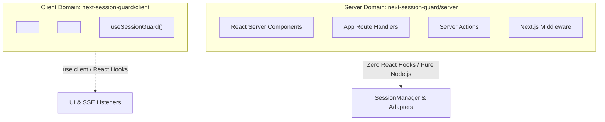

# Next.js 15 & Server/Client Boundary Guide ⚡

Next.js 15 introduces strict runtime boundary enforcement between **Server Components**, **Client Components**, **Server Actions**, and **Route Handlers**. 

**Next-Session-Guard** (v2.0.1) is engineered from the ground up to respect these boundaries with 100% clean separation of concerns.

---

## 🧩 The Two Primary Entrypoints



### 1. `next-session-guard/server`
- Contains zero React hooks (`useState`, `useEffect`, etc.).
- Safe for Server Actions, API Route Handlers, React Server Components (RSC), and Middleware.
- Never pulls React DOM or Lucide into server bundles.

### 2. `next-session-guard/client`
- Marked with `"use client";`.
- Contains interactive UI components (`<ActiveSessionsCard />`, `<AdminSecurityPanel />`) and the `useSessionGuard` hook.
- Requires React 18 or 19 and `lucide-react`.

---

## 1. Using in React Server Components (RSC)

You can read and validate sessions directly in your Server Components without any client-side waterfalls or loading spinners:

```tsx
// app/dashboard/page.tsx
import { cookies } from "next/headers";
import { redirect } from "next/navigation";
import { sessionManager } from "@/lib/session";

export default async function DashboardPage() {
  const cookieStore = await cookies();
  const token = cookieStore.get("session_token")?.value;

  if (!token) {
    redirect("/login");
  }

  const validation = await sessionManager.validateSession(token);
  if (!validation.isValid || !validation.session) {
    redirect("/login?expired=true");
  }

  const activeSessions = await sessionManager.getUserActiveSessions(validation.session.userId);

  return (
    <main className="p-8">
      <h1 className="text-3xl font-bold">Welcome back!</h1>
      <p className="text-gray-600">Active sessions: {activeSessions.length}</p>
    </main>
  );
}
```

---

## 2. Using with Next.js Server Actions

You can revoke sessions directly using Next.js Server Actions with zero API routes needed:

```typescript
// app/actions/session-actions.ts
"use server";

import { revalidatePath } from "next/cache";
import { cookies } from "next/headers";
import { sessionManager } from "@/lib/session";

export async function revokeDeviceAction(sessionId: string) {
  const cookieStore = await cookies();
  const token = cookieStore.get("session_token")?.value;

  if (!token) throw new Error("Unauthorized");

  const validation = await sessionManager.validateSession(token);
  if (!validation.isValid) throw new Error("Unauthorized");

  // Revoke target session
  await sessionManager.revokeSession(sessionId);

  revalidatePath("/dashboard/settings/sessions");
  return { success: true };
}
```

---

## 3. Route Handlers: Best Practices

When building Route Handlers for SSE or session management in Next.js 15, always explicitly mark dynamic execution:

```typescript
// app/api/sessions/route.ts
import { NextResponse } from "next/server";
import { sessionManager } from "@/lib/session";

// Essential: Prevents Next.js from caching dynamic auth routes at build time
export const dynamic = "force-dynamic";

export async function GET(req: Request) {
  // ...
}
```

---

## 4. Middleware Boundary

Next.js Middleware runs in a restricted Edge runtime. Keep your middleware imports minimal:

```typescript
// middleware.ts
import { NextResponse, type NextRequest } from "next/server";
import { cacheAdapter } from "@/lib/cache"; // Fast Edge Cache only

export async function middleware(req: NextRequest) {
  const token = req.cookies.get("session_token")?.value;
  if (!token) return NextResponse.next();

  // Validate against fast Edge blacklist cache
  const isBlacklisted = await cacheAdapter.isBlacklisted(token);
  if (isBlacklisted) {
    const res = NextResponse.redirect(new URL("/login?revoked=true", req.url));
    res.cookies.delete("session_token");
    return res;
  }

  return NextResponse.next();
}
```
