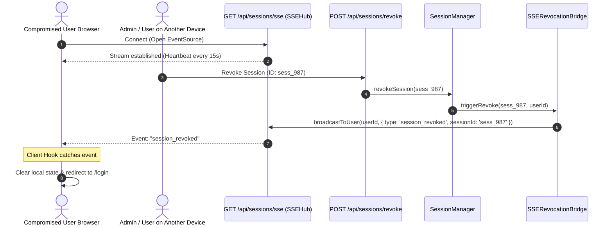

# Real-Time SSE Revocation 📡

Traditional session management relies on polling or waiting for a user to navigate to a new page before checking if their session has been revoked. If an attacker has an active tab open, they can continue stealing data and executing unauthorized actions until their cookie expires.

**Next-Session-Guard** solves this with a real-time **Server-Sent Events (SSE)** revocation mesh (`next-session-guard/realtime`). When a session is terminated—whether by the user from another device, an administrator from the `<AdminSecurityPanel />`, or a Telegram SOC incident responder—the target browser tab is **immediately locked and redirected in real time without any page refresh**.

---

## ⚡ Why SSE Instead of WebSockets?

| Metric | Server-Sent Events (SSE) | WebSockets (WS) |
| :--- | :--- | :--- |
| **Protocol** | Standard HTTP/1.1 & HTTP/2 | Custom WS / WSS handshake |
| **Multiplexing** | Shared over single HTTP/2 connection | Separate TCP connection per tab |
| **Auto-Reconnection** | Native browser-level reconnect & backoff | Requires custom JavaScript heartbeat & reconnect logic |
| **Load Balancer Support** | Works through standard proxies, CDNs, & Cloudflare | Often requires sticky sessions & special proxy configs |
| **Memory Consumption** | Extremely lightweight (~4KB per stream) | Heavy (~30KB+ per connection state) |

---

## 🏛️ Real-Time Architecture



---

## 🛠️ Step-by-Step Implementation

### Step 1: Create the SSE Route Handler

Create `app/api/sessions/sse/route.ts`:

```typescript
// app/api/sessions/sse/route.ts
import { sseHub } from "@/lib/session";
import { getSessionTokenFromCookies } from "@/lib/auth";

export const dynamic = "force-dynamic";

export async function GET(req: Request) {
  // 1. Identify the authenticated user
  const token = getSessionTokenFromCookies(req);
  if (!token) {
    return new Response("Unauthorized", { status: 401 });
  }

  const session = await sessionManager.validateSession(token);
  if (!session.isValid || !session.session) {
    return new Response("Unauthorized", { status: 401 });
  }

  // 2. Return the active SSE stream
  return sseHub.createStreamResponse(session.session.userId, {
    clientSessionId: session.session.id
  });
}
```

---

### Step 2: Connect the Revocation Bridge

In your `lib/session.ts`:

```typescript
// lib/session.ts
import { SessionManager, createPrismaAdapter } from "next-session-guard/server";
import { SSEHub, createSSERevocationBridge } from "next-session-guard/realtime";
import { prisma } from "@/lib/prisma";

export const sseHub = new SSEHub({
  heartbeatIntervalMs: 15000,
  maxConnectionsPerUser: 10
});

export const revocationBridge = createSSERevocationBridge(sseHub);

export const sessionManager = new SessionManager(createPrismaAdapter(prisma), {
  onRevoke: (revokedSession) => {
    // Automatically alerts the SSE Hub whenever any session is revoked
    revocationBridge.notifyRevocation({
      sessionId: revokedSession.id,
      userId: revokedSession.userId
    });
  }
});
```

---

### Step 3: Listen on the Frontend (`useSessionGuard`)

Wrap your root layout or authenticated application shell with the `useSessionGuard` hook:

```tsx
// components/SessionGuardListener.tsx
"use client";

import { useSessionGuard } from "next-session-guard/client";
import { useRouter } from "next/navigation";

export function SessionGuardListener() {
  const router = useRouter();

  useSessionGuard({
    sseUrl: "/api/sessions/sse",
    onRevoked: (data) => {
      // Triggered the instant this session is revoked remotely
      router.push("/login?reason=revoked_remotely");
    },
    onError: (err) => {
      console.warn("SSE connection error (auto-reconnecting):", err);
    }
  });

  return null;
}
```

Then mount it inside `app/layout.tsx`:

```tsx
// app/layout.tsx
import { SessionGuardListener } from "@/components/SessionGuardListener";

export default function RootLayout({ children }: { children: React.ReactNode }) {
  return (
    <html lang="en">
      <body>
        <SessionGuardListener />
        {children}
      </body>
    </html>
  );
}
```

---

## 🛡️ Edge Cases & Resilience

1. **Browser Tab Sleep & Throttling:** Browsers often throttle timers in background tabs. Next-Session-Guard uses an automatic heartbeat with `visibilitychange` listeners to resync session status immediately upon waking.
2. **Network Interruption:** If a user temporarily loses connectivity (e.g. entering an elevator), the native `EventSource` protocol automatically retries with exponential backoff and recovers the connection without reloading the page.
3. **Multi-Tab Sync:** If a user revokes their session from Tab A, Tabs B, C, and D are notified and terminated simultaneously.
